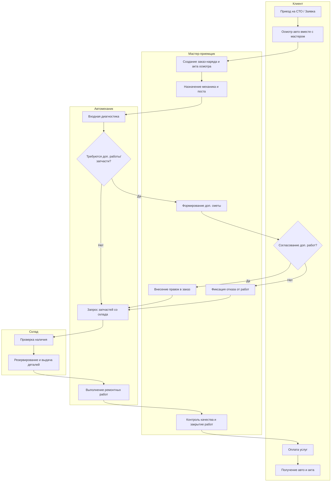

### 1. Диаграмма Бизнес-процесс выполнения сервисных работ (Activity / BPMN)
Показывает сквозной процесс взаимодействия ролей: Клиент, Мастер-приемщик, Механик и Склад.

## 2. Жизненный цикл документа «Заказ-наряд» (State Machine Diagram)
Отражает смену состояний центрального документа системы в соответствии с бизнес-правилами.

## 3. Реляционная модель данных (ER-Диаграмма)
Отражает ключевые бизнес-сущности и связи между ними.

